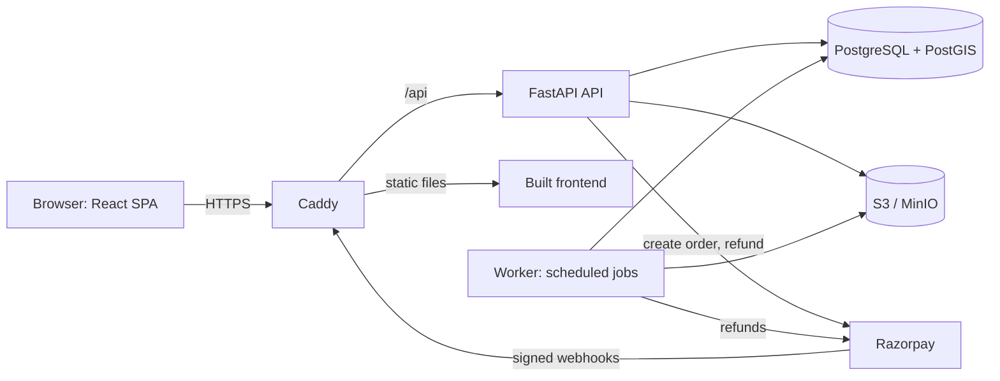

# Smart Printing Network

A web platform that connects customers with nearby verified print shops.
Upload a PDF, a Word document, an Excel sheet or a PowerPoint deck, choose
print options, see the price from the shop's own rate card, pay, and
collect your order with a short pickup code. Shops work a queue of paid
orders from a counter screen.

> **Status:** Phase 1 is built end to end. A customer can upload, get a
> price, pay, and collect. A shop can accept, print, mark ready and hand
> over against the pickup code. The worker expires unpaid orders, rejects
> orders no shop picked up, retries refunds and deletes old files. An
> order can be paid online or in cash at the counter, and an admin panel
> approves the shops that are allowed to take orders. A customer can find
> the shops near them, share a pickup code on WhatsApp, and print the
> same job again while the file is still stored.
> Payments run in Razorpay **test mode only**. No real money moves and shop
> payouts are out of scope.

**testable**, **deployable**, **explainable**.

[](https://github.com/areyypriyanshu/smart-printing-network/actions/workflows/ci.yml)
[](https://github.com/areyypriyanshu/smart-printing-network/actions/workflows/ci.yml)

---

## What it does, by phase

| Phase | Scope | Status |
|---|---|---|
| 1 | Accounts and roles, PDF upload and validation, print options, server-side pricing, payment and signed webhooks, pickup code, vendor queue, refunds, timeouts, file retention. Pickup only. | **Built** |
| 1.5 | Pay at the shop: the same order, paid in cash at the counter. The data a settlement would need is recorded; the settlement is not built. | **Built** |
| 1.6 | Print the file the customer actually has: Word, Excel and PowerPoint files are converted to PDF and printed. An error that names the fix. Print it again, share the pickup code, a phone number for the shop, and the shops near you. | **Built** |
| 2 | PDF quality checker (effective DPI and blur), price comparison, map view. The list of shops by distance is built. | Planned |
| 3 | Live queue and wait estimates from real order history, WebSocket updates, estimate accuracy report. ML only if the data justifies it. | Planned |

## What it deliberately does not do

- No delivery, no delivery tracking, no route optimisation (OR-Tools). Pickup only.
- No CNN or deep learning. Blur and resolution checks use classical image analysis because it is enough and it is explainable.
- No "AI price prediction". Price is arithmetic: `pages x copies x shop rate`, with a minimum order amount.
- No vendor payouts or settlements, no GST invoicing, no email or SMS notifications, no admin UI.

## Architecture at a glance



One origin, one TLS terminator, no CORS, and the refresh cookie is always
first party.

## Tech stack

- **Frontend:** React 19, TypeScript, Vite, TanStack Query, React Hook Form, Zod, Tailwind CSS
- **Backend:** Python 3.12, FastAPI, SQLAlchemy 2, Alembic, Pydantic v2
- **Data:** PostgreSQL with PostGIS, S3-compatible object storage (MinIO locally)
- **PDF and images (Phase 2):** PyMuPDF, OpenCV
- **Payments:** Razorpay (test mode) behind a gateway interface, with a fake gateway for tests. A second method, cash at the counter, sits behind the same interface
- **Infra:** Docker Compose, Caddy, GitHub Actions, single instance with S3

## Quickstart

Prerequisites: Git, Docker Desktop (Windows or macOS) or Docker Engine
(Linux), and `make`. On Windows, use WSL2 for `make`, or run the
underlying commands from the `Makefile` directly.

For the fast, native checks (`make check`, `make test-fe`) you also need
[uv](https://docs.astral.sh/uv/) and Node 22 (`frontend/.nvmrc`), then
`uv sync` in `backend/` and `npm ci` in `frontend/`.

```bash
git clone https://github.com/areyypriyanshu/smart-printing-network.git
cd smart-printing-network
cp .env.example .env      # local defaults, PAYMENT_PROVIDER=fake
make up                   # builds and starts api, worker, db, minio, frontend
make migrate              # applies database migrations
make seed                 # three verified shops, one customer
```

The PostGIS image is published for amd64 only, so `docker-compose.yml`
pins the `db` service to `linux/amd64`; on Apple Silicon Docker Desktop
runs it through Rosetta emulation automatically. `make up` copies
`.env.example` to `.env` if missing.

| What | URL |
|---|---|
| App | http://localhost:5173 |
| API docs (OpenAPI) | http://localhost:8000/docs |
| MinIO console | http://localhost:9001 |
| pgAdmin (database browser) | http://localhost:5050 |

Demo accounts, created by `make seed` (local and CI only, never production):

| Role | Email | Password |
|---|---|---|
| Customer | customer@example.com | spn-demo-password |
| Vendor (shop 1) | vendor1@example.com | spn-demo-password |
| Vendor (shop 2) | vendor2@example.com | spn-demo-password |
| Vendor (shop 3) | vendor3@example.com | spn-demo-password |

Seeded shops are verified and accepting orders. A vendor that
self-registers through the app starts unverified, and somebody has to
approve it. There are two ways to do that.

**From the command line**, which is what a server with no admin account
set up yet uses:

```bash
# See the shops that are waiting for a decision
docker compose run --rm api python -m app.cli list-shops --pending

# Approve one
docker compose run --rm api python -m app.cli verify-shop <vendor-email>

# Take a shop off the market
docker compose run --rm api python -m app.cli suspend-shop <vendor-email> --reason "..."
```

**From the admin panel**, once an admin account exists. There is no
endpoint that creates one, on purpose: an admin is the person who decides
which shops are allowed to take orders, so the account is created by
somebody who already holds the server.

```bash
docker compose run --rm api python -m app.cli create-admin you@example.com <password>
```

Then sign in at `/admin/shops`. The panel approves and suspends shops, and
keeps a log of every decision. It cannot read a customer's order or move
money; see [ADR 014](docs/adr/014-admin-panel.md).

### Managing the admin accounts themselves

Admin accounts are managed from the command line, by whoever holds the
server. There is no endpoint that lists or removes one.

```bash
# Who holds admin access
docker compose run --rm api python -m app.cli list-admins

# Revoke someone's access. It takes effect at once, not at token expiry:
# both the login and every authenticated request check the account.
docker compose run --rm api python -m app.cli deactivate-admin <email>

# Give the access back
docker compose run --rm api python -m app.cli activate-admin <email>

# Delete an account that has never done anything
docker compose run --rm api python -m app.cli delete-admin <email>
```

Deactivating is the normal way to remove access, and it is the better
one. The account is kept, so the decisions it made stay attached to it in
the moderation log, and the log is the reason the panel exists. A hard
delete is only possible for an account with no recorded decision, no
session, no order, no upload and no shop, because five tables point at
`users.id` and none of them cascade.

Two guards stop the obvious accidents. The last active admin cannot be
deactivated or deleted, because that would leave nobody who can undo it
from the panel; create another one first. And an account that has
recorded a decision cannot be deleted at all.

### Looking at the data

The database is PostgreSQL 16 with PostGIS. It runs in the `db` container
and is published on port 5432 of the host, so any Postgres tool on the
machine can reach it. There are three ways to look at what is in it.

**pgAdmin**, in the browser, is the one that behaves like a MySQL
workbench: a tree of tables on the left, rows on the right, and a query
tool for everything else. It is already running as part of `make up` on
<http://localhost:5050>. Sign in with `admin@example.com` and the password
`spn` (the local default; set `PGADMIN_EMAIL` and `PGADMIN_PASSWORD` in
`.env` to change it), then open the `spn (local)` server. The connection
is configured already, password included, so there is nothing to type.

```bash
make db-ui                  # start it on its own
```

The pgAdmin account is created the first time the container starts, so
changing `PGADMIN_PASSWORD` in `.env` afterwards does not change it.
Delete the container and its volume to start over, then bring it back:

```bash
docker compose --profile tools rm -sf pgadmin
docker volume rm spn_pgadmin_data    # the name carries the Compose project name
make db-ui
```

**psql**, in the terminal, when the question is one sentence long:

```bash
make db-shell               # an interactive session
```

```
\dt                                           -- the tables
\d orders                                     -- the columns, constraints and indexes
SELECT order_no, status, price_paise FROM orders ORDER BY created_at DESC LIMIT 10;
\q                                            -- leave
```

The same thing without the session, for scripts:

```bash
docker compose exec -T db psql -U spn -d spn -c "SELECT count(*) FROM orders;"
```

**The schema reference**, `docs/DATABASE_SCHEMA.md`, lists every table,
column, constraint and index, and the queries that matter. It is the
answer to "what should this table look like"; the database is the answer
to "what is in it right now".

### The same stack with HTTPS, the way it is deployed

The production Compose file runs locally too, so the whole path can be
exercised before there is a domain:

```bash
docker compose -f docker-compose.prod.yml up -d --build
docker compose -f docker-compose.prod.yml run --rm api alembic upgrade head
docker compose -f docker-compose.prod.yml exec -T api python -m app.cli seed
```

Caddy issues a certificate from its own local authority, so the browser
warns once. To trust it:

```bash
docker compose -f docker-compose.prod.yml exec -T caddy \
  cat /data/caddy/pki/authorities/local/root.crt > caddy-ca.crt
sudo security add-trusted-cert -d -k /Library/Keychains/System.keychain caddy-ca.crt
```

Then the app is on <https://localhost>.

## Try the whole flow in one command

`infra/scripts/smoke-test.sh` walks the product the way a person would:
the customer signs in, uploads a PDF, sees a price, pays; the shop finds
the order in the queue, accepts it, starts printing, marks it ready; the
customer downloads the file; a wrong pickup code is refused; the right one
completes the order.

```bash
make smoke                                   # against the dev stack
BASE_URL=https://localhost CURL_CA_BUNDLE=./caddy-ca.crt infra/scripts/smoke-test.sh
```

It checks the answer at every step, so it fails loudly rather than
printing a summary that looks fine.

## Common commands

| Command | What it does |
|---|---|
| `make check` | Lint, type check, import contracts and all fast tests. Run before every commit. |
| `make test-unit` | Pure domain tests (pricing, state machine, backoff). Milliseconds. |
| `make test-api` | API and integration tests against a real Postgres. |
| `make test-jobs` | Background job tests with a frozen clock. |
| `make test-fe` | Frontend component tests (Vitest). |
| `make coverage` | The whole suite with coverage, then the coverage floors. |
| `make e2e` | Playwright journeys and accessibility checks against the full stack. |
| `make smoke` | The end to end product flow against a running stack. |
| `make openapi` | Exports `backend/openapi.json` and regenerates `frontend/src/api/schema.d.ts`. |
| `make db-shell` | An interactive psql session against the local database. |
| `make db-ui` | Starts the pgAdmin database browser on <http://localhost:5050>. |
| `make reset` | Wipes local volumes and rebuilds from scratch. |

## Testing

- **Unit:** the pricing rule, the order state machine and the refund
  backoff, including property-based tests with Hypothesis.
- **API and integration:** real PostgreSQL with PostGIS, the fake payment
  gateway and in-memory storage. Covers webhook replay, parallel webhook
  delivery, concurrent accept, authorization on every endpoint, and the
  background jobs.
- **End to end:** Playwright against the whole Compose stack, plus axe
  accessibility checks at WCAG 2.1 A and AA.
- **Contract:** Schemathesis fuzzes the API from its own OpenAPI schema,
  with a token so the authenticated endpoints are reached too. It found a
  real bug: registering a shop with an email that already existed returned
  a 500 instead of a 409.
- **Coverage floors**, enforced in CI: 90% on `domain`, 90% on `services`,
  80% overall. Currently 100%, 93% and 92%.
- **CI:** six jobs, backend, frontend, contract, end to end, OpenAPI drift
  and a secret scan.

## Deploying

The production stack is `docker-compose.prod.yml` with Caddy in front. It
runs locally, which is the fastest way to see the whole thing.

For a real deployment, push to `main` and the deploy workflow builds the
image, runs the migrations as a one-off container, deploys, smoke checks
`/readyz`, and rolls back to the previous image tag if the check fails.

The deploy job is skipped until a target is configured. To set one up:

1. An AWS instance with Docker, a domain pointing at it, and ports 80 and
   443 open.
2. Repository secrets: `DEPLOY_HOST`, `DEPLOY_SSH_KEY`, `POSTGRES_PASSWORD`,
   `S3_SECRET_KEY`. A repository variable `DEPLOY_ENABLED` set to `true`.
3. An environment variable `SPN_DOMAIN` on the `production` environment.
4. `ACME_EMAIL` in the instance's `.env`, so Caddy can register the ACME
   account.

The migrations are backward compatible with the previous version, so a
rollback is a redeploy of the previous tag.

## Documentation

The planning documents live on the maintainer's machine and are not
committed. The decisions are.

| Doc | Purpose |
|---|---|
| [`AGENTS.md`](AGENTS.md) | Rules and workflow for AI agents and contributors |
| [`docs/DECISIONS.md`](docs/DECISIONS.md) | **Start here.** Why the project is built the way it is |
| [`docs/adr/`](docs/adr/) | One architecture decision record per decision |

## Engineering decisions worth reading

1. **The webhook, not the browser, decides that an order is paid.** The
   signature is checked on the raw bytes, the event id deduplicates, and
   the amount and currency must match. A late payment is refunded.
2. **One function changes an order's status**, and it does a compare and
   swap, so two shops clicking Accept at once produce one winner. The
   status change and its history row commit together.
3. **The database checks the price.** `price_paise = GREATEST(page_count
   x copies x rate_paise, min_order_paise)` is a constraint, so a bug in
   the application cannot store a wrong price.
4. **The domain layer is pure**, and an import linter contract fails the
   build if it ever imports a framework.
5. **The payment provider sits behind an interface** with a real fake, so
   the whole money path runs the same way in the tests, locally and in
   the demo.
6. **Background work is database driven**, with no Redis and no Celery.
   Five functions, rows claimed with `SKIP LOCKED`, safe to run twice.

## Known limitations

- Payments are test mode. Vendor payouts are not implemented, and the
  platform takes no cut of a cash order. It records the amount, the
  method, the shop, the time the money changed hands and the vendor who
  took it, so a settlement can be built later without a data migration.
  See [ADR 013](docs/adr/013-cash-on-collection.md).
- One shop per vendor account, one order per upload, whole-document printing only (no page ranges, no binding options).
- A converted Word, Excel or PowerPoint file keeps the text, the headings, the pictures and the table contents. It does not keep the fonts, the exact table widths, the headers, the footers or the columns. A student who needs the exact layout uploads a PDF. See [ADR 016](docs/adr/016-office-file-upload.md).
- No email verification or password reset.
- Single-instance deployment. The rate limiter lives in the process, so a
  second API instance would need Redis. A login is limited per account
  and per address, so a campus behind one address is not locked out.
- The vendor board polls every five seconds. WebSockets arrive in the
  phase where a live board needs them.

## Author

Priyanshu Mandal,
GitHub: [areyypriyanshu](https://github.com/areyypriyanshu) | LinkedIn: [areyypriyanshu](https://linkedin.com/in/areyypriyanshu)
