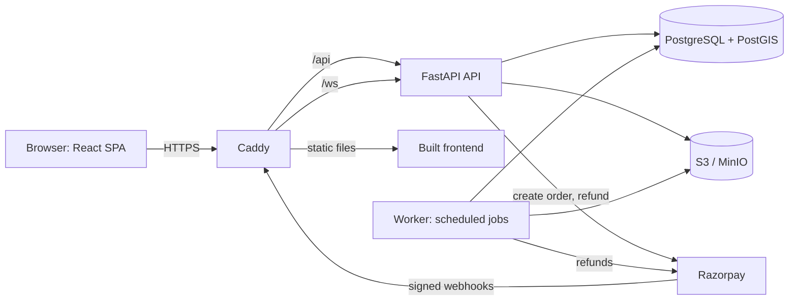

# Smart Printing Network

A web platform that connects customers with nearby verified print shops.
Upload a PDF, a Word document, an Excel sheet or a PowerPoint deck, choose
print options, see the price from the shop's own rate card, pay, and
collect your order with a short pickup code. Shops work a queue of paid
orders from a counter screen.

> **Status:** Phases 1 and 2 are built end to end. A customer can upload,
> get a price, pay, and collect. A shop can accept, print, mark ready and
> hand over against the pickup code. The worker expires unpaid orders,
> rejects orders no shop picked up, retries refunds and deletes old files.
> An order can be paid online or in cash at the counter, and an admin panel
> approves the shops that are allowed to take orders. A customer can check
> a PDF before printing, find the shops near them, compare their prices,
> see them on a map, share a pickup code on WhatsApp, and print the same
> job again while the file is still stored. Sprint 9 adds a queue-wait
> range from real order events, with a Rough label when history is thin,
> and a walk-forward accuracy report. ML is explicitly rejected on the
> current simulated evidence. Sprint 10 adds WebSocket live updates: order
> status changes push to the shop board and the customer's order page in
> real time, with polling fallback when the socket drops.
> Payments run in Razorpay **test mode only**. No real money moves and shop
> payouts are out of scope.

**testable**, **deployable**, **explainable**.

[](https://github.com/areyypriyanshu/smart-printing-network/actions/workflows/ci.yml)
[](https://github.com/areyypriyanshu/smart-printing-network/actions/workflows/ci.yml)

---

## What it does, by phase

| Phase | Scope | Status |
|---|---|---|
| 1 | Accounts and roles, PDF upload and validation, print options, server-side pricing, payment and signed webhooks, pickup code, vendor queue, refunds, timeouts, file retention. Pickup only. | **Built** |
| 1.5 | Pay at the shop: the same order, paid in cash at the counter. The data a settlement would need is recorded; the settlement is not built. | **Built** |
| 1.6 | Print the file the customer actually has: Word, Excel and PowerPoint files are converted to PDF and printed. An error that names the fix. Print it again, share the pickup code, a phone number for the shop, and the shops near you. | **Built** |
| 2 | PDF quality checker (effective DPI and blur), shop search, price comparison, map view, load baseline. | **Built** |
| 3 | Sprint 9: queue-wait ranges from order events, batched shop-list estimates and an order-page estimate, simulated history and a leakage-free backtest. **Built**. Sprint 10: WebSocket live updates push order status changes to the shop board and customer order page, with polling fallback when the socket drops. **Built**. | **Sprint 9 and 10 built** |

## What it deliberately does not do

- No delivery, no delivery tracking, no route optimisation (OR-Tools). Pickup only.
- No CNN or deep learning. Blur and resolution checks use classical image analysis because it is enough and it is explainable.
- No "AI price prediction". Price is arithmetic: `pages x copies x shop rate`, with a minimum order amount.
- No ML wait prediction. Queue estimates use recent speed quartiles and current unfinished work. A model would have to beat that rule on time-separated real data; simulated history cannot justify one. See [ADR 033](docs/adr/033-wait-estimates-and-the-ml-decision.md).
- No vendor payouts or settlements, no GST invoicing, no email or SMS notifications, no admin UI. The one message the platform sends is the link that proves an email address, which is part of the account rather than a notification.

## Architecture at a glance



One origin, one TLS terminator, no CORS, and the refresh cookie is always
first party.

## Tech stack

- **Frontend:** React 19, TypeScript, Vite, TanStack Query, React Hook Form, Zod, Tailwind CSS
- **Backend:** Python 3.12, FastAPI, SQLAlchemy 2, Alembic, Pydantic v2
- **Data:** PostgreSQL with PostGIS, S3-compatible object storage (MinIO locally)
- **PDF and images:** PyMuPDF, OpenCV (headless). The quality checker measures effective DPI and blur with classical methods, calibrated on a labelled fixture set
- **Payments:** Razorpay (test mode) behind a gateway interface, with a fake gateway for tests. A second method, cash at the counter, sits behind the same interface
- **Map:** Google Maps JavaScript API, loaded only when the customer scrolls to it, behind a key restricted by referrer and API
- **Load:** k6 against quotes, shop search and the vendor queue, with the baseline in [`perf/BASELINE.md`](perf/BASELINE.md)
- **Infra:** Docker Compose, Caddy, GitHub Actions, single instance with S3

## Quickstart

Prerequisites: Git, Docker Desktop (Windows or macOS) or Docker Engine
(Linux), and `make`. On Windows, use WSL2 for `make`, or run the
underlying commands from the `Makefile` directly.

For the fast, native checks (`make check`, `make test-fe`) you also need
[uv](https://docs.astral.sh/uv/) and Node 22 (`frontend/.nvmrc`), then
`uv sync` in `backend/` and `npm ci` in `frontend/`.

```bash
git clone https://github.com/areyypriyanshu/smart-printing-network.git
cd smart-printing-network
make up                   # copies .env.example, generates the secrets, starts everything
make migrate              # applies database migrations
make seed                 # three verified shops, one customer
```

The PostGIS image is published for amd64 only, so `docker-compose.yml`
pins the `db` service to `linux/amd64`; on Apple Silicon Docker Desktop
runs it through Rosetta emulation automatically.

`make up` copies `.env.example` to `.env` if it is missing, and then
replaces the placeholders in it with generated secrets: the JWT secret,
the fake gateway's webhook key, the database password, the object store
password and the pgAdmin password. The values that ship in
`.env.example` are public, because the template is in the repository, so
a fresh checkout does not run on them. A value you have already changed
is left alone.

Every port the local stack publishes is bound to `127.0.0.1`, so the
database, the object store, the API and pgAdmin are not reachable from
the network your laptop is on.

| What | URL |
|---|---|
| App | http://localhost:5173 |
| API docs (OpenAPI) | http://localhost:8000/docs |
| MinIO console | http://localhost:9001 |
| pgAdmin (database browser) | http://localhost:5050 |

Demo accounts, created by `make seed` (local and CI only, never production):

| Role | Email |
|---|---|
| Customer | customer@example.com |
| Vendor (shop 1) | vendor1@example.com |
| Vendor (shop 2) | vendor2@example.com |
| Vendor (shop 3) | vendor3@example.com |

They have no password, because there is no password here any more: the
sign in is the identity provider's. On a local machine the provider is
stood in for by the local way in, which asks for the address and
nothing else. See [ADR 029](docs/adr/029-clerk-authentication-with-local-authorization.md).

### Signing up, and the two kinds of account

The sign in and the address belong to the identity provider, so making
an account is the provider's form and this application never holds a
password. What the application decides is what the account is *for*,
and it asks that once, at the one page a new account meets.

There are two kinds of account and a person has one of them for good. A
customer's history belongs to the customer, and a shop's history belongs
to the shop, so a customer who later decides to run a shop needs a
separate account. See [ADR 025](docs/adr/025-the-limits-on-creating-an-account.md).

**A customer** follows "Create an account" or "Sign in", and is asked
what they are here for: to print something, or to run a shop.

**A shop owner** follows the link that says **"Register your shop"**,
and is asked for the shop: its name, its address and where it is. They
are not asked what they are here for, because they have already said it,
and the account they make is the shop's account and not a customer's.
The shop waits for the team to look at it before it takes orders, so a
shop that is registered is not yet a shop that can print.

The coordinates of the shop are optional. The easiest way is the
**"Use my current location"** button: a shop owner is standing in their
shop when they register, the browser knows where they are, and it is
exact and free. Failing that, the owner types the coordinates, or
leaves them empty and lets the address be looked up on the map.

The lookup happens on the server, so the map provider's key never
reaches the browser. It is free by default: OpenStreetMap's geocoder
needs no key and no account, and the rules it asks for — one call a
second for the whole application, a user agent that says who is asking,
the answers cached, and the attribution shown on the page — are in the
code and in the tests. A deployment that would rather use the
commercial provider, or no provider at all, changes one setting. See
[ADR 030](docs/adr/030-the-address-is-looked-up-on-the-server.md) and
[ADR 031](docs/adr/031-the-free-geocoder-and-the-rules-that-come-with-it.md).

A person who came to register a shop and is here to print after all can
say so on that page, and the reason is dropped with it.

The provider's identifier for a person is what the operator needs to
make them an administrator; the provider's dashboard shows it.

Seeded shops are verified and accepting orders. A vendor that
self-registers through the app starts unverified, and somebody has to
approve it. There are two ways to do that.


**From the command line**, which is what a server with no admin account
set up yet uses:

```bash
# See the shops that are waiting for a decision
docker compose run --rm api python -m app.cli list-shops --pending

# Approve one
docker compose run --rm api python -m app.cli verify-shop <vendor-email>

# Take a shop off the market
docker compose run --rm api python -m app.cli suspend-shop <vendor-email> --reason "..."
```

**From the admin panel**, once an admin account exists. There is no
endpoint that creates one, on purpose: an admin is the person who decides
which shops are allowed to take orders, so the account is created by
somebody who already holds the server.

```bash
docker compose run --rm api python -m app.cli create-admin user_2abcDEF
```

The argument is the identity provider's identifier for the person, which
the provider's dashboard shows. The command reads the address and the
name from the provider, so the administrator is the person the provider
says they are and not the person the shell says they are, and there is
no password to invent: the sign in is the provider's.

Then sign in at `/admin/shops`. The panel approves and suspends shops, and
keeps a log of every decision. It cannot read a customer's order or move
money; see [ADR 014](docs/adr/014-admin-panel.md).

### Finding a shop, and comparing prices

A customer goes to `/shops`. They can share their location with the
browser, type an area, or do neither: a customer who says no to the
location prompt still gets the whole list of shops. The radius is a
selector, and the list can be ordered by distance or by price.

Choosing a file on that page is optional. With one, every shop shows
what it would charge for that file with the chosen options, and the
price is the price of the order: the search and the checkout call the
same pricing function, so there is nothing to disagree about. A shop
that does not offer those options is left out of the comparison rather
than shown with a price nobody can pay.

Choosing "Order from this shop" carries the file, the options and the
shop into the order wizard, where the customer can change any of them
before paying.

The same shops appear on a map above the shop list, one pin per shop
with its price. The map is drawn only when it is scrolled into view, and it is
never the only way to see the shops: if the deployment has no key, the
script is blocked, or the platform is being read by a screen reader, the
list is still there with the same shops, distances and prices. The
browser's key is public and is restricted by the websites and the one
API that may use it; the server's geocoding key never reaches the page.
See [ADR 032](docs/adr/032-the-map-is-drawn-last.md).

### Understanding the queue estimate

Shop cards and the order page show a range for one narrow thing: how long a
**new arrival** might wait from entering the shop's queue until printing
starts. It is not a promised start or ready time for an existing order.
`PAID`, cash `RESERVED`, `ACCEPTED` and `PRINTING` work counts; unpaid and
already-ready orders do not. A currently printing order counts at full size
because SPN does not record page-level progress.

The range uses the p25, median and p75 of the shop's last 50 valid minutes per
page-copy samples. It is a heuristic range, not a confidence interval. Fewer
than 10 samples uses documented defaults and is labelled **Rough**. An empty
queue is `0–0 min`. List responses include estimates in batch, while the order
page calls `GET /shops/{id}/wait-estimate`; a failed estimate never blocks shop
selection. See [ADR 033](docs/adr/033-wait-estimates-and-the-ml-decision.md).

To reproduce the evaluation data and report locally:

```bash
make seed                  # create the demo shops first
make seed-history          # 30 completed orders per shop; simulated, not real activity
make backtest-estimates    # writes backend/estimate_backtest.json
```

`make seed-history` is deterministic, replaces only the server-owned
`simulated-history/` storage-key dataset (never a customer order that happens
to reuse the idempotency-key prefix), and stops the worker while backdated
intermediate states are written. The orders go through the real create/transition services. No PDF
objects are stored for this metadata-only history.

The committed simulated report evaluates 89 of 90 orders (the first is baseline
warm-up): rule MAE **3.4140 minutes** versus expanding-global-average MAE
**5.9899 minutes**. This validates the evaluation pipeline on simulated data;
it is not a production accuracy claim or evidence for ML. Per-shop numbers and
the 29 rough predictions are in [`backend/estimate_backtest.json`](backend/estimate_backtest.json).

### Managing the admin accounts themselves

Admin accounts are managed from the command line, by whoever holds the
server. There is no endpoint that lists or removes one.

```bash
# Who holds admin access
docker compose run --rm api python -m app.cli list-admins

# Revoke someone's access. It takes effect at once, not at token expiry:
# both the login and every authenticated request check the account.
docker compose run --rm api python -m app.cli deactivate-admin <email>

# Give the access back
docker compose run --rm api python -m app.cli activate-admin <email>

# Delete an account that has never done anything
docker compose run --rm api python -m app.cli delete-admin <email>
```

### The accounts that were made and never used

An account with no order, no upload and no session since it was created
is an account that somebody made and then did nothing with: a mistyped
address, a test, or spam. They are listed, and the operator decides what
happens to them.

```bash
# List them. Nothing is changed.
docker compose run --rm api python -m app.cli prune-unused-accounts

# Deactivate them. The address stays taken, so nobody else can claim it,
# and the account can be given back with activate-account.
docker compose run --rm api python -m app.cli prune-unused-accounts --apply

# Give one account back
docker compose run --rm api python -m app.cli activate-account <email>
```

Nothing is deleted, because a customer who signed up last week and has
not printed anything yet looks exactly like an account nobody wants.
See [ADR 025](docs/adr/025-the-limits-on-creating-an-account.md).

Deactivating is the normal way to remove access, and it is the better
one. The account is kept, so the decisions it made stay attached to it in
the moderation log, and the log is the reason the panel exists. A hard
delete is only possible for an account with no recorded decision, no
session, no order, no upload and no shop, because five tables point at
`users.id` and none of them cascade.

Two guards stop the obvious accidents. The last active admin cannot be
deactivated or deleted, because that would leave nobody who can undo it
from the panel; create another one first. And an account that has
recorded a decision cannot be deleted at all.

### Confirming an email address

The identity provider proves the address, because the provider holds it
and the provider sends the sign in. A person who makes an account is
sent a code, and the account works once the code is answered. This
application reads the provider's answer and never holds a password, so
there is nothing here for it to prove and nothing for it to leak.

On a development instance the provider never sends a message to an
address that ends in `+clerk_test`, and the code for it is always
`424242`. That is what the local stack and the end to end suite use.

A customer who typed their address wrong puts the right one there
themselves, in the identity provider's own settings.

### Looking at the data

The database is PostgreSQL 16 with PostGIS. It runs in the `db` container
and is published on port 5432 of the host, so any Postgres tool on the
machine can reach it. There are three ways to look at what is in it.

**pgAdmin**, in the browser, is the one that behaves like a MySQL
workbench: a tree of tables on the left, rows on the right, and a query
tool for everything else. It is already running as part of `make up` on
<http://localhost:5050>. Sign in with `admin@example.com` and the password
`spn` (the local default; set `PGADMIN_EMAIL` and `PGADMIN_PASSWORD` in
`.env` to change it), then open the `spn (local)` server. The connection
is configured already, password included, so there is nothing to type.

```bash
make db-ui                  # start it on its own
```

The pgAdmin account is created the first time the container starts, so
changing `PGADMIN_PASSWORD` in `.env` afterwards does not change it.
Delete the container and its volume to start over, then bring it back:

```bash
docker compose --profile tools rm -sf pgadmin
docker volume rm spn_pgadmin_data    # the name carries the Compose project name
make db-ui
```

**psql**, in the terminal, when the question is one sentence long:

```bash
make db-shell               # an interactive session
```

```
\dt                                           -- the tables
\d orders                                     -- the columns, constraints and indexes
SELECT order_no, status, price_paise FROM orders ORDER BY created_at DESC LIMIT 10;
\q                                            -- leave
```

The same thing without the session, for scripts:

```bash
docker compose exec -T db psql -U spn -d spn -c "SELECT count(*) FROM orders;"
```

**The schema reference**, `docs/DATABASE_SCHEMA.md`, lists every table,
column, constraint and index, and the queries that matter. It is the
answer to "what should this table look like"; the database is the answer
to "what is in it right now".

### The same stack with HTTPS, the way it is deployed

The production Compose file runs locally too, so the whole path can be
exercised before there is a domain:

```bash
docker compose -f docker-compose.prod.yml up -d --build
docker compose -f docker-compose.prod.yml run --rm api alembic upgrade head
docker compose -f docker-compose.prod.yml exec -T api python -m app.cli seed
```

Caddy issues a certificate from its own local authority, so the browser
warns once. To trust it:

```bash
docker compose -f docker-compose.prod.yml exec -T caddy \
  cat /data/caddy/pki/authorities/local/root.crt > caddy-ca.crt
sudo security add-trusted-cert -d -k /Library/Keychains/System.keychain caddy-ca.crt
```

Then the app is on <https://localhost>.

## Try the whole flow in one command

`infra/scripts/smoke-test.sh` walks the product the way a person would:
the customer signs in, uploads a PDF, asks for the quality check and
waits for the worker to measure the file, sees a price, pays; the shop
finds the order in the queue, accepts it, starts printing, marks it
ready; the customer downloads the file; a wrong pickup code is refused;
the right one completes the order.

```bash
make smoke                                   # against the dev stack
BASE_URL=https://localhost CURL_CA_BUNDLE=./caddy-ca.crt infra/scripts/smoke-test.sh
```

It checks the answer at every step, so it fails loudly rather than
printing a summary that looks fine.

## Common commands

| Command | What it does |
|---|---|
| `make check` | Lint, type check, import contracts and all fast tests. Run before every commit. |
| `make test-unit` | Pure domain tests (pricing, state machine, backoff). Milliseconds. |
| `make test-api` | API and integration tests against a real Postgres. |
| `make test-jobs` | Background job tests with a frozen clock. |
| `make test-fe` | Frontend component tests (Vitest). |
| `make coverage` | The whole suite with coverage, then the coverage floors. |
| `make e2e` | Playwright journeys and accessibility checks against the full stack. |
| `make smoke` | The end to end product flow against a running stack. |
| `make openapi` | Exports `backend/openapi.json` and regenerates `frontend/src/api/schema.d.ts`. |
| `make db-shell` | An interactive psql session against the local database. |
| `make db-ui` | Starts the pgAdmin database browser on <http://localhost:5050>. |
| `make seed-history` | Deterministic **simulated** completed orders through the real services; local only. |
| `make backtest-estimates` | Walk-forward per-shop MAE against an expanding global-average baseline. |
| `make perf-seed` | 200 reserved cash orders for the load test, made through the real services. |
| `make perf-explain` | The search and queue plans, with synthetic rows, rolled back. |
| `make reset` | Wipes local volumes and rebuilds from scratch. |

## Testing

- **Unit:** the pricing rule, the order state machine and the refund
  backoff, including property-based tests with Hypothesis, and the quality
  rules against a labelled fixture set, plus pure estimate math, percentile,
  validation and Hypothesis monotonicity properties.
- **Estimate evaluation:** real event histories replayed walk-forward, with a
  future-outlier no-look-ahead test, deterministic simulated seeding and a
  committed aggregate report. A report with no evaluable rows says so rather
  than inventing a zero error.
- **API and integration:** real PostgreSQL with PostGIS, the fake payment
  gateway and in-memory storage. Covers webhook replay, parallel webhook
  delivery, concurrent accept, authorization on every endpoint, and the
  background jobs.
- **End to end:** Playwright against the whole Compose stack, plus axe
  accessibility checks at WCAG 2.1 A and AA.
- **Contract:** Schemathesis fuzzes the API from its own OpenAPI schema,
  with a token so the authenticated endpoints are reached too. It found a
  real bug: registering a shop with an email that already existed returned
  a 500 instead of a 409.
- **Coverage floors**, enforced in CI: 90% on `domain`, 90% on `services`,
  80% overall. Currently 93.2%, 92.2% and 91.8% (788 backend tests passed,
  29 skipped as environment-specific).
- **Load:** k6 drives quotes, shop search and the vendor queue from four
  customer accounts and one vendor, for 30 seconds, against the local
  stack. The thresholds fail the run if a p95 crosses its target or a
  request fails. The numbers, the hardware and the index review are in
  [`perf/BASELINE.md`](perf/BASELINE.md); the script and its options are
  in [`perf/k6/`](perf/k6/).
- **CI:** six jobs, backend, frontend, contract, end to end, OpenAPI drift
  and a secret scan.

## Deploying

The production stack is `docker-compose.prod.yml` with Caddy in front. It
runs locally, which is the fastest way to see the whole thing.

For a real deployment, push to `main` and the deploy workflow builds the
image, runs the migrations as a one-off container, deploys, smoke checks
`/readyz`, and rolls back to the previous image tag if the check fails.

The deploy job is skipped until a target is configured. To set one up:

1. An AWS instance with Docker, a domain pointing at it, and ports 80 and
   443 open.
2. Repository secrets: `DEPLOY_HOST`, `DEPLOY_SSH_KEY`, `POSTGRES_PASSWORD`,
   `S3_SECRET_KEY`. A repository variable `DEPLOY_ENABLED` set to `true`.
3. An environment variable `SPN_DOMAIN` on the `production` environment.
4. `ACME_EMAIL` in the instance's `.env`, so Caddy can register the ACME
   account.
5. A repository variable `VITE_GOOGLE_MAPS_API_KEY` if the map is wanted.
   It is public and baked into the bundle at build time; the key itself
   is made safe by the referrer and API restrictions in the provider's
   console, not by being hidden. Leave it unset and the search page says
   the map is not switched on.

The migrations are backward compatible with the previous version, so a
rollback is a redeploy of the previous tag.

## Documentation

The planning documents live on the maintainer's machine and are not
committed. The decisions are.

| Doc | Purpose |
|---|---|
| [`AGENTS.md`](AGENTS.md) | Rules and workflow for AI agents and contributors |
| [`docs/DECISIONS.md`](docs/DECISIONS.md) | **Start here.** Why the project is built the way it is |
| [`docs/adr/`](docs/adr/) | One architecture decision record per decision |
| [`backend/estimate_backtest.json`](backend/estimate_backtest.json) | The simulated, aggregate Sprint 9 accuracy report |
| [`perf/BASELINE.md`](perf/BASELINE.md) | The phase 2 load baseline and the index review |
| [`perf/k6/`](perf/k6/) | The load script and how to run it |

## Engineering decisions worth reading

1. **The webhook, not the browser, decides that an order is paid.** The
   signature is checked on the raw bytes, the event id deduplicates, and
   the amount and currency must match. A late payment is refunded.
2. **One function changes an order's status**, and it does a compare and
   swap, so two shops clicking Accept at once produce one winner. The
   status change and its history row commit together.
3. **The database checks the price.** `price_paise = GREATEST(page_count
   x copies x rate_paise, min_order_paise)` is a constraint, so a bug in
   the application cannot store a wrong price.
4. **The domain layer is pure**, and an import linter contract fails the
   build if it ever imports a framework.
5. **The payment provider sits behind an interface** with a real fake, so
   the whole money path runs the same way in the tests, locally and in
   the demo.
6. **Background work is database driven**, with no Redis and no Celery.
   Six functions, rows claimed with `SKIP LOCKED`, safe to run twice.
7. **The quality check is measured, not guessed.** The thresholds come
   from a labelled fixture set: chosen on one half and reported on the
   half that was held out. The report is advice, so it never stops an
   order.
8. **The price on the shop search is the price of the order.** The search
   and the checkout call the same pricing function, so the number the
   customer compares is the number the customer is charged, and a test
   creates a real order to prove it.
9. **The address is looked up on the server, for free.** The browser
   never holds the map provider's key, and a shop owner who types their
   own coordinates is believed before any lookup is made. The default
   provider is OpenStreetMap's, which needs no key and no account, and
   the rules its policy asks for are tests rather than habits. See
   [ADR 030](docs/adr/030-the-address-is-looked-up-on-the-server.md) and
   [ADR 031](docs/adr/031-the-free-geocoder-and-the-rules-that-come-with-it.md).
10. **The map is drawn last, and the list is the map that always works.**
    The provider's script is fetched when the customer scrolls to it,
    not when the page opens. The browser key is public and is made safe
    by the provider's restrictions; a deployment with no key, a blocked
    script or a screen reader still gets the list, with the same shops
    and prices. See [ADR 032](docs/adr/032-the-map-is-drawn-last.md).
11. **Estimates are evaluated, not labelled intelligent.** A queue-wait range
    comes from current unfinished units and recent event-derived speed
    quartiles. The backtest uses only information available at each prediction
    point and compares MAE with an expanding global average. Simulated data
    tests the plumbing, but cannot justify ML. See
    [ADR 033](docs/adr/033-wait-estimates-and-the-ml-decision.md).
12. **Live updates are a committed notification, not a change feed.** A
    transition writes its notification in the same transaction as its event, so
    a rolled-back order announces nothing, and the socket is only a hint that
    every client resyncs from. Authorization is object-level and derived on the
    server, so a vendor socket can only ever be that shop and a customer socket
    only that customer's order. Polling stays as the fallback. See
    [ADR 034](docs/adr/034-websocket-live-updates.md).

## Known limitations

- Payments are test mode. Vendor payouts are not implemented, and the
  platform takes no cut of a cash order. It records the amount, the
  method, the shop, the time the money changed hands and the vendor who
  took it, so a settlement can be built later without a data migration.
  See [ADR 013](docs/adr/013-cash-on-collection.md).
- One shop per vendor account, one order per upload, whole-document printing only (no page ranges, no binding options).
- A page cannot cost more than ₹500. The price of an order is pages x
  copies x rate, the largest order the platform takes is 300 pages of
  100 copies, and the column that holds the price is a 32 bit integer.
  The ceiling is what keeps the largest possible order inside it, and
  without it a shop could price an order the database cannot hold, and
  the failure would land on the customer who tried to order. A rate
  stored before the ceiling existed is still read back, so one old
  rate cannot make the list of shops fail to load.
- A converted Word, Excel or PowerPoint file keeps the text, the headings, the pictures and the table contents. It does not keep the fonts, the exact table widths, the headers, the footers or the columns. A student who needs the exact layout uploads a PDF. See [ADR 016](docs/adr/016-office-file-upload.md).
- The password belongs to the identity provider, so a password reset is
  the provider's to offer. It is switched on in the provider's settings,
  and it sends the message, so the platform cannot reset one itself.
  See
  [ADR 029](docs/adr/029-clerk-authentication-with-local-authorization.md).
- Single-instance deployment. The rate limiter and the live-update hub live in
  the process, so a second API instance would need a shared transport (Redis or
  a broker). A login is limited per account and per address, so a campus behind
  one address is not locked out. See
  [ADR 008](docs/adr/008-single-instance-docker-compose.md) and
  [ADR 034](docs/adr/034-websocket-live-updates.md).
- The vendor board polls every five seconds as fallback. WebSocket live
  updates push order status changes to the shop board and customer order
  page in real time (Sprint 10). Polling takes over when the socket is
  closed or unavailable. See
  [ADR 034](docs/adr/034-websocket-live-updates.md).
- Queue estimates are only as reliable as vendor clicks. Late or batched Start
  and Ready actions distort the event-derived speed. A currently printing
  order counts at full size, and the range is not a confidence interval or a
  ready-time promise. The only accuracy report so far uses clearly labelled
  simulated history; real pilot data is still needed before making an accuracy
  claim or reconsidering ML.
- The map is optional by design. It needs a Google Cloud project, the
  Maps JavaScript API, a billing account and a key restricted by the
  websites that may use it. Without a key the search still works and the
  page says the map is not switched on. The map is covered by component
  tests for the loader and the states, not by a browser test that draws
  real tiles, because that would need a real key in CI.
- The quality thresholds are calibrated on a generated fixture set, not on
  real customer files. The set is reproducible and free of personal
  documents, but real uploads would be better evidence, and adding a
  labelled real file is the next step. See
  [ADR 028](docs/adr/028-the-quality-check-runs-in-the-worker.md).
- Turning an address into a point uses the free OpenStreetMap geocoder
  by default. It matches loosely: an address that does not exist comes
  back as the nearest place it knows, which is why the shop owner's own
  coordinates are the first choice. The service is run on donated
  servers, so a deployment with real traffic should point
  `NOMINATIM_BASE_URL` at its own instance or use the commercial
  provider. See
  [ADR 031](docs/adr/031-the-free-geocoder-and-the-rules-that-come-with-it.md).

## Author

Priyanshu Mandal,
GitHub: [areyypriyanshu](https://github.com/areyypriyanshu) | LinkedIn: [areyypriyanshu](https://linkedin.com/in/areyypriyanshu)
