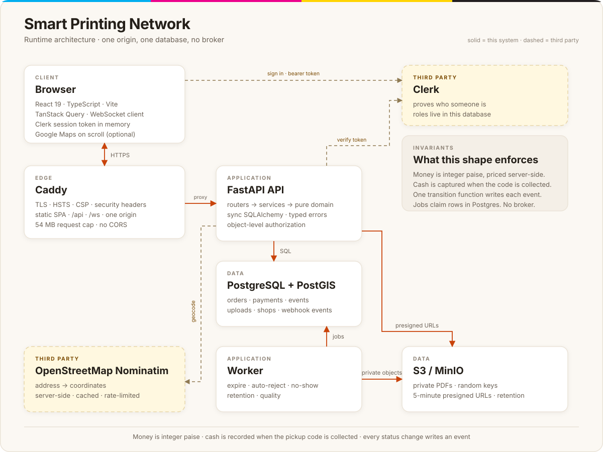

<div align="center">

<h1>Smart Printing Network</h1>

<p><strong>Upload a document. Compare nearby print shops. Pay. Collect with a short code.</strong></p>

<p>A full-stack printing marketplace built end to end with React, FastAPI and PostgreSQL. It takes a real file from upload to pickup, defends the money path with adversarial tests, and writes down every decision that was not obvious.</p>

<p>
  <a href="https://github.com/areyypriyanshu/smart-printing-network/actions/workflows/ci.yml"></a>
  <a href="docs/PROJECT_SUMMARY.md#by-the-numbers"></a>
  
  
  
</p>

<p>
  <a href="#architecture-at-a-glance">Architecture</a> ·
  <a href="#quickstart">Quickstart</a> ·
  <a href="#how-it-works">How it works</a> ·
  <a href="#testing-and-evidence">Testing</a> ·
  <a href="#documentation">Docs</a>
</p>

</div>

> [!IMPORTANT]
> Payments run in Razorpay **test mode only**. No real money moves, vendor payouts are not implemented, and the platform takes no cut of a cash order.

---

## What it does

One place to print something without walking to three shops to ask for a price.

| Capability | What it means |
|---|---|
| **Any common document** | PDF, Word, Excel or PowerPoint. Office files are converted to PDF with the standard library and PyMuPDF, and the quote counts the pages that will actually be printed. |
| **A price you can trust** | Integer paise, computed only on the server. Search and checkout call the same function, and a database `CHECK` repeats the arithmetic as a last line of defence. |
| **Compare nearby shops** | Verified shops by distance, price and queue wait, in a list that works on its own and an optional map that loads only when it is scrolled into view. |
| **Pay how you like** | Razorpay test mode with signed webhooks, or reserve now and pay cash at the counter. |
| **Proof at pickup** | A short code that the shop checks in constant time and rate limits against guessing. Online orders get theirs only after the payment webhook; cash orders get theirs when they reserve. |
| **Check before printing** | Effective DPI and blur measured in the worker, with a warning that names the problem instead of a score nobody can act on. |
| **Live updates** | Order changes pushed over a WebSocket to the shop board and the customer's order page, with polling that takes over when the socket drops. |
| **Built to operate** | Timeouts, auto-rejection, refund retries, file retention, shop approvals and an audit trail, all driven from the database. |

**Status.** Phase 1 (accounts, upload, pricing, payment, pickup, vendor queue, refunds, retention), 1.5 (cash at the counter), 1.6 (Office files, reprint, code sharing, nearby shops), 2 (quality check, search, map, load baseline) and 3 (wait estimates, WebSocket live updates) are built end to end.

**Not built, on purpose.**

- No delivery, delivery tracking or route optimisation. Pickup only.
- No CNN or deep learning. The quality check is classical image analysis: measurable, explainable and enough.
- No ML price or wait prediction. A rule must be beaten by evidence first, and simulated history cannot justify a model. See [ADR 033](docs/adr/033-wait-estimates-and-the-ml-decision.md).
- No vendor payouts, GST invoicing, email or SMS notifications, or general admin UI. The admin panel only approves and suspends shops.
- No page ranges, binding, multi-file orders, ratings or QR codes.

## Architecture at a glance

<p align="center">
  
</p>

<p align="center"><sub>Solid lines are this system. Dashed lines are third parties. The browser is the only client, and Caddy is the only public entry point. <a href="docs/architecture.svg">Open the diagram full size.</a></sub></p>

One origin, one database, no broker. Caddy serves the built React app and proxies `/api` and `/ws` to FastAPI, so there is no CORS configuration and the session token is held in memory rather than in an auth cookie. The API and the worker are separate processes over the same PostgreSQL and private object storage. There is no queue to operate. Clerk proves who a person is; the role and every authorization decision stay in this database.

| Component | Responsibility |
|---|---|
| **Browser** | React 19 SPA. TanStack Query for server state, a WebSocket client with polling fallback, and a Clerk session token kept in memory. The map is optional and loads on scroll. |
| **Caddy** | The only public entry point. TLS, HSTS, CSP, security headers, static assets, `/api` and `/ws` on one origin, and a 54 MB request cap that sits above the 50 MB upload limit. |
| **API** | FastAPI with sync SQLAlchemy. Routers delegate to services; pricing and state rules live in a pure domain layer; authorization is object-level and lives in the services. |
| **Worker** | Expires unpaid orders, auto-rejects orders no shop accepts, expires uncollected cash orders, retries refunds, purges expired files and measures quality. Claims rows with `SKIP LOCKED`, so it is safe to run twice. |
| **PostgreSQL + PostGIS** | Orders, payments, events, uploads, shops and webhook deduplication. Holds the price `CHECK` and the partial indexes the queue and search rely on. |
| **S3 / MinIO** | Private PDFs under random keys, reachable only through five-minute presigned URLs. Retention is enforced by `delete_after`, not by a cron script outside the app. |
| **Clerk** | Proves identity and owns the password. The local account is keyed on the provider's subject, never on the email. |
| **Razorpay** | Test-mode orders, refunds and signed, deduplicated webhooks. The webhook, not the browser, decides that an online order is paid. |
| **Nominatim** | Server-side address lookup, cached and rate limited. The commercial provider's key, if one is configured, never reaches the browser. |

### How a request moves

1. The browser asks Clerk for a short-lived session token and sends it as a bearer token. The application sets no auth cookie of its own.
2. Caddy terminates TLS, serves the built SPA, and proxies `/api` and `/ws` to FastAPI. Same origin means no CORS.
3. The API verifies the token, loads the local account by the provider's subject, and applies an ownership filter in the service. Cross-tenant access is a 404.
4. PostgreSQL is the system of record. PDFs go to a private bucket and reach the browser only through a five-minute presigned URL.
5. The worker shares the database and bucket but no in-memory state. Restarting it loses nothing; running two is safe.
6. Razorpay webhooks arrive through Caddy. The API verifies the signature on the raw body and commits the effect once.

## Quickstart

Prerequisites: Git, Docker Desktop (Windows or macOS) or Docker Engine (Linux), and `make`. On Windows, use WSL2 for `make`, or run the underlying commands from the [Makefile](Makefile).

```bash
git clone https://github.com/areyypriyanshu/smart-printing-network.git
cd smart-printing-network

make up          # generate local secrets, then start the stack
make migrate     # apply the database migrations
make seed        # three verified shops and demo accounts
```

`make up` copies `.env.example` to `.env`, replaces the placeholders with generated secrets, and leaves values you have already changed alone. Every published port is bound to `127.0.0.1`, so the database, object store and API are not reachable from the network your laptop is on.

| What | Where |
|---|---|
| App | <http://localhost:5173> |
| API docs (OpenAPI) | <http://localhost:8000/docs> |
| MinIO console | <http://localhost:9001> |
| pgAdmin | <http://localhost:5050> |

The PostGIS image is published for amd64 only, so the `db` service is pinned to `linux/amd64`; on Apple Silicon, Docker Desktop runs it through Rosetta automatically.

For the native checks (`make check`, `make test-fe`) you also need [uv](https://docs.astral.sh/uv/) and Node 22 (`frontend/.nvmrc`), then `uv sync` in `backend/` and `npm ci` in `frontend/`.

<details>
<summary><strong>Demo accounts and how sign-in works locally</strong></summary>

| Role | Email |
|---|---|
| Customer | `customer@example.com` |
| Vendor, shop 1 | `vendor1@example.com` |
| Vendor, shop 2 | `vendor2@example.com` |
| Vendor, shop 3 | `vendor3@example.com` |

These accounts have no password: sign-in belongs to Clerk. On the local stack the **local way in** stands in for the provider and asks for the address rather than a password; the production configuration refuses that route. On a Clerk development instance, an address ending in `+clerk_test` uses the code `424242`. See [ADR 029](docs/adr/029-clerk-authentication-with-local-authorization.md).

</details>

<details>
<summary><strong>Approve a shop, or create an admin</strong></summary>

Seeded shops are verified and accepting orders. A shop that registers through the app starts unverified and waits for a decision.

```bash
# What is waiting for a decision
docker compose run --rm api python -m app.cli list-shops --pending

# Approve one, or take one off the market
docker compose run --rm api python -m app.cli verify-shop <vendor-email>
docker compose run --rm api python -m app.cli suspend-shop <vendor-email> --reason "..."
```

An admin account is created from the command line, because no endpoint creates one on purpose. The argument is the identity provider's user id, which its dashboard shows.

```bash
docker compose run --rm api python -m app.cli create-admin <provider-user-id>
```

Then sign in at `/admin/shops`. The panel approves and suspends shops and keeps a log of every decision. It cannot read a customer's order or move money. See [ADR 014](docs/adr/014-admin-panel.md).

</details>

<details>
<summary><strong>Look inside the database</strong></summary>

PostgreSQL 16 with PostGIS runs in the `db` container and is published on port 5432. `make db-shell` opens a psql session; pgAdmin is at <http://localhost:5050> with `admin@example.com` and `spn` (local defaults). The schema reference is kept with the local planning documents. See [ADR 015](docs/adr/015-database-browser-for-local-development.md).

</details>

<details>
<summary><strong>Run the production stack locally</strong></summary>

```bash
docker compose -f docker-compose.prod.yml up -d --build
docker compose -f docker-compose.prod.yml run --rm api alembic upgrade head
```

Then open <https://localhost> after trusting Caddy's local certificate authority. The production configuration refuses `seed`: demo shops and accounts are local-only. Register a shop through the app and approve it with the CLI above.

</details>

<details>
<summary><strong>Walk the whole flow in one command</strong></summary>

`make smoke` signs in, uploads a PDF, waits for the worker's quality check, sees a price and pays; the shop accepts, prints, marks ready and hands over; the customer downloads the file; a wrong pickup code is refused and the right one completes the order. It checks the answer at every step and fails loudly instead of printing a summary that looks fine.

</details>

## How it works

### The signed webhook decides that an online order is paid

The browser can be closed, offline or malicious, so a client callback never marks an online order paid. An online order exists as `PENDING_PAYMENT` before checkout. When Razorpay calls back, the API verifies the signature on the raw bytes, deduplicates by event id, checks the amount and currency, and commits the payment, the order transition and its event in one transaction. A late payment is refunded. For an online order, the pickup code is generated only after the webhook, so an unpaid online order never carries a usable code. See [ADR 004](docs/adr/004-webhook-is-the-source-of-truth.md) and [ADR 022](docs/adr/022-the-webhook-event-and-its-effect-are-one-transaction.md).

### The price is computed once, on the server

Price is arithmetic: `pages × copies × shop rate`, with a minimum order amount, in integer paise. Search and checkout call the same pricing function, so the number a customer compares is the number they are charged. The client may send an expected price, but it is a guard, not the truth, and a database `CHECK` repeats the calculation. Cash orders reuse the same machinery: `RESERVED` when the customer books, `COLLECTED` and `CAPTURED` together when the shop takes the money. See [ADR 010](docs/adr/010-price-invariant-enforced-by-the-database.md) and [ADR 013](docs/adr/013-cash-on-collection.md).

### Identity is proved elsewhere; authorization lives here

Clerk owns the password, the address and the session. The API keys the local account on the provider's subject rather than the email, reads the role from the database, and enforces ownership filters in the services. A missing check in a router cannot leak another customer's order, and cross-tenant access returns 404. A deactivated account stops working at once, not at token expiry. See [ADR 029](docs/adr/029-clerk-authentication-with-local-authorization.md) and [ADR 025](docs/adr/025-the-limits-on-creating-an-account.md).

### The quality check is measured, not guessed

Office files are converted to PDF, then the worker measures effective DPI and blur with classical image analysis. The thresholds were chosen on one half of a labelled fixture set and reported on the half that was held out. The result is advice that names the problem, not a label that blocks an order. See [ADR 016](docs/adr/016-office-file-upload.md), [ADR 028](docs/adr/028-the-quality-check-runs-in-the-worker.md) and [ADR 006](docs/adr/006-classical-image-analysis-not-a-cnn.md).

### Search, map and waits are honest about their limits

Address lookup happens on the server with OpenStreetMap's Nominatim, cached and rate limited, so the commercial provider's key never reaches the browser. The Google map is optional, loads on scroll, and is never the only way to see the shops. Queue waits are a rule-based range from recent order events, labelled **Rough** when history is thin; a walk-forward backtest is the evidence, and simulated data cannot justify ML. See [ADR 030](docs/adr/030-the-address-is-looked-up-on-the-server.md), [ADR 031](docs/adr/031-the-free-geocoder-and-the-rules-that-come-with-it.md), [ADR 032](docs/adr/032-the-map-is-drawn-last.md) and [ADR 033](docs/adr/033-wait-estimates-and-the-ml-decision.md).

### Live updates are notifications, not a second source of truth

A transition writes its notification in the same transaction as its event, so a rolled-back order announces nothing. The socket is a hint that every client resyncs from; the database is still the truth. Channels are authorized per shop or per order, a customer cannot subscribe to someone else's order, and polling remains the fallback. See [ADR 034](docs/adr/034-websocket-live-updates.md) and [ADR 007](docs/adr/007-polling-before-websockets.md).

## Testing and evidence

The suite is the spec, not an afterthought. Money and authorization get adversarial tests rather than only happy paths.

| Measure | Result | Source |
|---|---|---|
| Backend tests | **819 passed, 29 skipped** | `make coverage`, real PostgreSQL 16 + PostGIS 3.6; skips are environment-specific |
| Frontend tests | **168 passed** in 27 files | `make test-fe` (Vitest and Testing Library) |
| Coverage | **91.7%** overall · **93.2%** domain · **92.4%** services | Floors of 80/90/90 enforced in CI |
| Quote latency | p95 **25.4 / 25.8 ms** over two runs | k6, 120 requests per run |
| Shop search latency | p95 **137.2 / 133.1 ms** | k6, 60 requests per run; spatial index in the plan |
| Vendor queue latency | p95 **61.0 / 28.4 ms** at **238 active orders** | k6, 30 requests per run; partial index used |
| Wait-estimate accuracy | MAE **3.4140 min** vs **5.9899 min** for a global-average baseline | Walk-forward over 89 **simulated** orders |
| CI | **6 jobs**, 3m53s last measured | Before the dependency-audit steps were added |

What the tests actually prove:

- **Payments:** forged signatures, duplicate delivery, wrong amounts, late payments and parallel webhooks. A late payment is refunded, and a duplicate can only apply once.
- **Orders and authorization:** two shops accepting at once produce one winner. Every endpoint has an allowed and a forbidden-actor test, and cross-tenant reads return 404.
- **Jobs:** frozen-time tests, run-twice idempotency and concurrent workers with `SKIP LOCKED`.
- **Schema:** migrations pass up, down, up; every new `CHECK` and unique rule has a constraint test.
- **End to end:** Playwright over the whole Compose stack with axe checks at WCAG 2.1 A and AA. One journey drops the live socket and proves the vendor board falls back to polling.
- **Contract:** Schemathesis fuzzes the API from its own OpenAPI schema. It found a real bug: registering a shop with an existing email returned 500 instead of 409.

All numbers are local or CI measurements from the Sprint 11 pass (2026-10-22 to 2026-10-25). They are evidence for this stack, not a production benchmark or an accuracy claim. The load method and index review are in [perf/BASELINE.md](perf/BASELINE.md); the aggregate accuracy report is in [backend/estimate_backtest.json](backend/estimate_backtest.json).

## Deploying

The production stack is [docker-compose.prod.yml](docker-compose.prod.yml): Caddy, the API, the worker, PostgreSQL and S3. Push to `main` and the deploy workflow builds the image, runs the migrations as a one-off container, deploys, smoke checks `/readyz`, and rolls back to the previous image tag if the check fails. Migrations are expand-and-contract, so a rollback is a redeploy. See [ADR 023](docs/adr/023-the-deployment-runs-the-commit-it-reviewed.md).

The deploy job is skipped until a target is configured.

<details>
<summary><strong>Deployment prerequisites</strong></summary>

1. An AWS instance with Docker, a domain pointing at it, and ports 80 and 443 open.
2. Repository secrets: `DEPLOY_HOST`, `DEPLOY_SSH_KEY`, `POSTGRES_PASSWORD`, `S3_SECRET_KEY`. A repository variable `DEPLOY_ENABLED` set to `true`.
3. An environment variable `SPN_DOMAIN` on the `production` environment.
4. `ACME_EMAIL` in the instance's `.env`, so Caddy can register the ACME account.
5. A repository variable `VITE_GOOGLE_MAPS_API_KEY` if the map is wanted. It is public and baked into the bundle; the provider's referrer and API restrictions are what make it safe, not secrecy. Without it, search works and the page says the map is off.

</details>

## Documentation

The planning documents live with the maintainer and are not committed. The decisions are.

| Doc | Purpose |
|---|---|
| [`AGENTS.md`](AGENTS.md) | The operating manual: rules, workflow and definition of done |
| [`docs/DECISIONS.md`](docs/DECISIONS.md) | **Start here.** The decisions and why they were made |
| [`docs/adr/`](docs/adr/) | One architecture decision record per non-trivial decision |
| [`docs/PROJECT_SUMMARY.md`](docs/PROJECT_SUMMARY.md) | One page of measurable facts, for a resume or a reviewer |
| [`docs/SECURITY_REVIEW.md`](docs/SECURITY_REVIEW.md) | The final security pass: audits, headers, storage and residual risks |
| [`docs/architecture.svg`](docs/architecture.svg) | The runtime diagram used in this README |
| [`backend/estimate_backtest.json`](backend/estimate_backtest.json) | The simulated, aggregate accuracy report |
| [`perf/BASELINE.md`](perf/BASELINE.md) | The load baseline and index review |
| [`perf/k6/`](perf/k6/) | The load script and how to run it |

## Engineering decisions worth reading

| Decision | Why it matters | ADR |
|---|---|---|
| The signed webhook is the source of truth | A browser can lie or disappear; the money path cannot depend on it | [004](docs/adr/004-webhook-is-the-source-of-truth.md) |
| The price is checked by the database | An application bug cannot store a wrong price | [010](docs/adr/010-price-invariant-enforced-by-the-database.md) |
| The payment provider sits behind an interface with a real fake | The whole money path runs the same way in tests and locally, with no network | [009](docs/adr/009-payment-gateway-interface.md) |
| Background work is database-driven | No Redis or Celery until a measured trigger; `SKIP LOCKED` instead | [003](docs/adr/003-database-driven-jobs.md) |
| Clerk proves identity, this database authorizes | A provider cannot write a role or read another tenant's order | [029](docs/adr/029-clerk-authentication-with-local-authorization.md) |
| Office files become PDFs with the standard library and PyMuPDF | Print the file the customer actually has, and quote the pages that will be printed | [016](docs/adr/016-office-file-upload.md) |
| The quality check is measured on held-out fixtures | A warning a printer can act on, not fake intelligence | [028](docs/adr/028-the-quality-check-runs-in-the-worker.md) |
| Wait estimates stay rule-based | Simulated data cannot justify ML; the backtest makes the rule accountable | [033](docs/adr/033-wait-estimates-and-the-ml-decision.md) |
| Live updates are committed notifications | A rolled-back order announces nothing; the socket is only a hint | [034](docs/adr/034-websocket-live-updates.md) |

The rest, including the alternatives that were rejected, are in [DECISIONS.md](docs/DECISIONS.md) and the 34 ADRs.

## Known limitations

- Payments are test mode. Vendor payouts are not implemented, and the platform takes no cut of a cash order. It records the amount, method, shop, time and vendor so a settlement can be built later without a data migration.
- One shop per vendor account, one order per upload, and whole-document printing only. There are no page ranges, binding options, multi-file orders, ratings or QR codes.
- A converted Office file keeps the text, headings, pictures and table contents, but not the exact fonts, table widths, headers, footers or columns. A customer who needs the exact layout uploads a PDF.
- The deployment is single-instance. The rate limiter and the live-update hub live in the process, so a second API instance would need a shared transport.
- Queue estimates are only as reliable as vendor clicks. Late or batched Start and Ready actions distort the event-derived speed, and the only accuracy report so far uses clearly labelled simulated history.

<details>
<summary><strong>More limits, and what already mitigates them</strong></summary>

- The quality thresholds are calibrated on a generated fixture set, not real customer files. The set is reproducible and free of personal documents, but a labelled real file is the next step.
- The map needs a Google Cloud project and a referrer-restricted key. Without one the search still works and the page says the map is off. CI covers the loader and its states, not real map tiles.
- Address lookup defaults to the free Nominatim service, which matches loosely and runs on donated servers. A deployment with real traffic should point `NOMINATIM_BASE_URL` at its own instance or use the commercial provider.
- A page cannot cost more than ₹500. The ceiling keeps the largest possible order inside the 32-bit paise column, and a rate stored before the ceiling existed is still read back without breaking the shop list.
- Password reset belongs to the identity provider, so the application cannot reset one itself.

</details>

---

<div align="center">

<p><strong>Priyanshu Mandal</strong></p>

<p><a href="https://github.com/areyypriyanshu">GitHub</a> · <a href="https://linkedin.com/in/areyypriyanshu">LinkedIn</a></p>

<p><sub>Built as a portfolio project about software that is testable, deployable and explainable.</sub></p>

</div>
