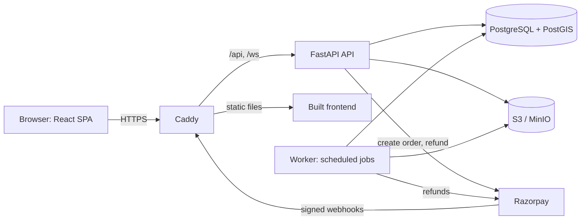

# Smart Printing Network

A web platform that connects customers with nearby verified print shops. Upload a PDF, choose print options, see the price, pay, and collect your order with a short pickup code. Shops get a vendor dashboard to manage their order queue.

Later phases add a PDF quality checker (flags blurry and low-resolution pages before printing), multi-shop search with price comparison, and live queue and wait estimates built from real order history.

> **Status:** Sprint 0 (foundation) complete: Compose stack, migrations, CI and app skeletons. Sprint 1 (accounts and roles) is next. Payments run in Razorpay **test mode only**. No real money moves and shop payouts are out of scope.

Built by Priyanshu Mandal as a portfolio project with three goals: **testable**, **deployable**, **explainable**.

---

## What it does, by phase

| Phase | Scope | Status |
|---|---|---|
| 1 | Accounts and roles, PDF upload and validation, print options, server-side pricing, Razorpay payment, pickup code, vendor queue, refunds and timeouts. Pickup only. | Planned |
| 2 | PDF quality checker (effective DPI and blur, PyMuPDF and OpenCV), geo search of shops, price comparison, map view | Planned |
| 3 | Live queue and wait estimates from real order history, WebSocket updates, estimate accuracy report. ML only if the data justifies it. | Planned |

## What it deliberately does not do

- No delivery, no delivery tracking, no route optimisation (OR-Tools). Pickup only.
- No CNN or deep learning. Blur and resolution checks use classical image analysis because it is enough and it is explainable. See `docs/TECH_STACK.md`.
- No "AI price prediction". Price is arithmetic: `pages x copies x shop rate`, with a minimum order amount.
- No vendor payouts or settlements, no GST invoicing, no email or SMS notifications, no admin UI. These are documented as backlog in `docs/PRD.md`.

## Architecture at a glance



Full detail, sequence diagrams and failure modes: `docs/ARCHITECTURE.md`.

## Tech stack

- **Frontend:** React, TypeScript, Vite, TanStack Query, Tailwind CSS
- **Backend:** Python 3.12, FastAPI, SQLAlchemy 2, Alembic, Pydantic v2
- **Data:** PostgreSQL with PostGIS, S3-compatible object storage (MinIO locally)
- **PDF and images (Phase 2):** PyMuPDF, OpenCV
- **Payments:** Razorpay (test mode) behind a gateway interface, with a fake gateway for tests
- **Infra:** Docker Compose, Caddy, GitHub Actions, single AWS instance (Lightsail or EC2) with S3

## Quickstart

Prerequisites: Git, Docker Desktop (Windows or macOS) or Docker Engine (Linux), and `make`.
On Windows, use WSL2 for `make`, or run the underlying commands from the `Makefile` directly.
For the fast, native checks (`make check`, `make test-fe`) you additionally need [uv](https://docs.astral.sh/uv/) (it fetches Python 3.12) and Node 22 (`frontend/.nvmrc`), then `uv sync` in `backend/` and `npm ci` in `frontend/`.
Optional git hooks: install [pre-commit](https://pre-commit.com/) and `gitleaks`, then `pre-commit install`.

```bash
git clone https://github.com/areyypriyanshu/smart-printing-network.git
cd smart-printing-network
cp .env.example .env      # local defaults, PAYMENT_PROVIDER=fake
make up                   # builds and starts api, worker, db, minio, frontend
make migrate              # applies database migrations
```

The PostGIS image is published for amd64 only, so `docker-compose.yml` pins the `db` service to `linux/amd64`; on Apple Silicon Docker Desktop runs it through Rosetta emulation automatically. `make up` copies `.env.example` to `.env` if missing.

| What | URL |
|---|---|
| App | http://localhost:5173 |
| API docs (OpenAPI) | http://localhost:8000/docs |
| MinIO console | http://localhost:9001 |

Demo accounts, created by `make seed` (local and CI only, never production):

| Role | Email | Password |
|---|---|---|
| Customer | customer@example.com | spn-demo-password |
| Vendor (shop 1) | vendor1@example.com | spn-demo-password |
| Vendor (shop 2) | vendor2@example.com | spn-demo-password |
| Vendor (shop 3) | vendor3@example.com | spn-demo-password |

Seeded shops are verified and accepting orders. A vendor that self-registers through the app
starts unverified; approve it locally with
`docker compose run --rm api python -m app.cli verify-shop <vendor-email>`.

Using real Razorpay test mode instead of the fake gateway: set `PAYMENT_PROVIDER=razorpay` and fill the three `RAZORPAY_*` values in `.env`. Webhooks need a public URL (use a tunnel) pointing at `/api/v1/webhooks/razorpay`.

## Common commands

| Command | What it does |
|---|---|
| `make check` | Lint, type check, and all fast tests. Run before every commit. |
| `make test-unit` | Pure domain tests (pricing, state machine). Milliseconds. |
| `make test-api` | API and integration tests against a real Postgres. |
| `make test-fe` | Frontend component tests (Vitest). |
| `make e2e` | Playwright end-to-end tests against the full Compose stack (arrives with the e2e scaffold). |
| `make openapi` | Exports `backend/openapi.json` and regenerates `frontend/src/api/schema.d.ts`. |
| `make reset` | Wipes local volumes and rebuilds from scratch. |

## Testing strategy

- **Unit:** pricing and order state machine, including property-based tests (Hypothesis).
- **API and integration:** real PostgreSQL with PostGIS, fake payment gateway and in-memory storage. Covers webhook replay, concurrent accept, authorization (IDOR) checks, expiry and refund jobs.
- **End to end:** Playwright runs the happy path and key failure paths. Accessibility checks with axe on key pages.
- **Contract:** Schemathesis fuzzes the API from its own OpenAPI schema in CI.
- **CI:** GitHub Actions runs everything on each push and builds images on `main`.

## Documentation

| Doc | Purpose |
|---|---|
| [`AGENTS.md`](AGENTS.md) | Rules and workflow for AI agents and contributors |
| [`docs/PRD.md`](docs/PRD.md) | Problem, scope, requirements, success metrics |
| [`docs/APP_FLOW.md`](docs/APP_FLOW.md) | Screens, journeys, order lifecycle, failure paths |
| [`docs/TECH_STACK.md`](docs/TECH_STACK.md) | Chosen tools, rejected options, revisit triggers |
| [`docs/FRONTEND_GUIDELINES.md`](docs/FRONTEND_GUIDELINES.md) | Frontend structure, state, UI and testing rules |
| [`docs/BACKEND_STRUCTURE.md`](docs/BACKEND_STRUCTURE.md) | Backend layers, endpoints, jobs, errors, config |
| [`docs/DATABASE_SCHEMA.md`](docs/DATABASE_SCHEMA.md) | DDL, indexes, migrations policy, key queries |
| [`docs/ARCHITECTURE.md`](docs/ARCHITECTURE.md) | System design, sequences, deployment, failure modes |
| [`docs/DATA_MODEL.md`](docs/DATA_MODEL.md) | Entities, invariants, data lifecycle, privacy |
| [`docs/IMPLEMENTATION_PLAN.md`](docs/IMPLEMENTATION_PLAN.md) | Sprints, acceptance criteria, phase gates, risks |

## Engineering decisions worth reading

1. **The webhook, not the browser, decides that an order is paid.** Idempotent, signature-verified, amount-checked.
2. **One function changes order status.** Illegal transitions are impossible by construction and covered by property tests.
3. **Classical image analysis instead of a CNN.** Effective DPI plus Laplacian variance, calibrated on a labelled fixture set, with the evaluation committed to the repo.
4. **Wait estimates are a rolling median from real order events**, benchmarked against a naive baseline. ML is only considered if the rule fails on enough real data.
5. **Polling before WebSockets.** WebSockets arrive in Phase 3 where they pay off.

Architecture decision records live in `docs/adr/`.

## Known limitations

- Payments are test mode. Vendor payouts are not implemented.
- One shop per vendor account, one order per upload, whole-document printing only (no page ranges, no binding options).
- No email verification or password reset.
- Single-instance deployment. Scaling triggers are documented in `docs/ARCHITECTURE.md`.

## Author

Priyanshu Mandal, final-year B.Tech Information Technology.
GitHub: [areyypriyanshu](https://github.com/areyypriyanshu) | LinkedIn: [areyypriyanshu](https://linkedin.com/in/areyypriyanshu)
